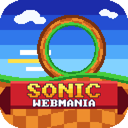
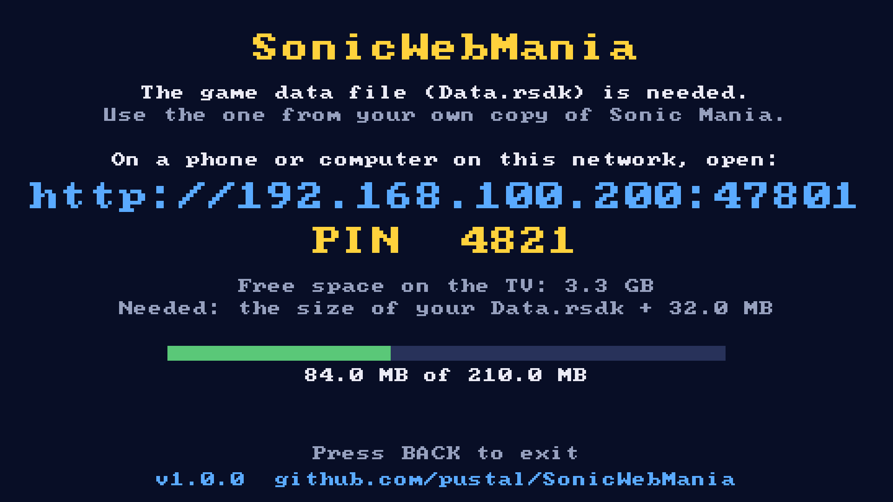
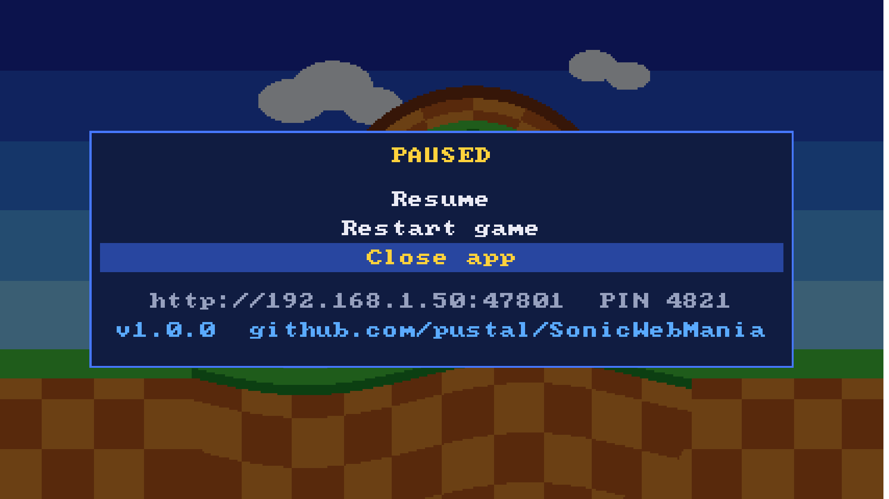
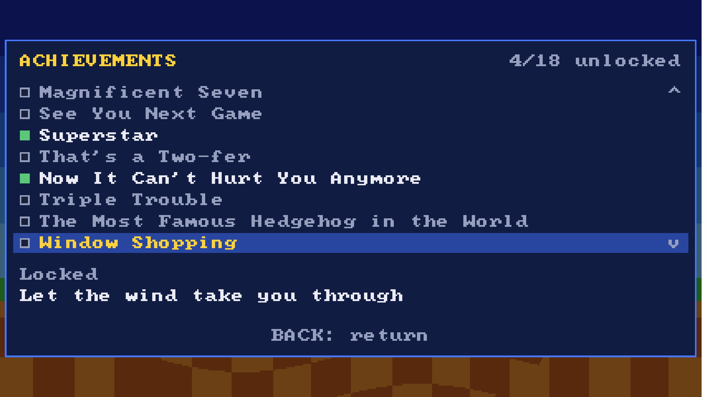
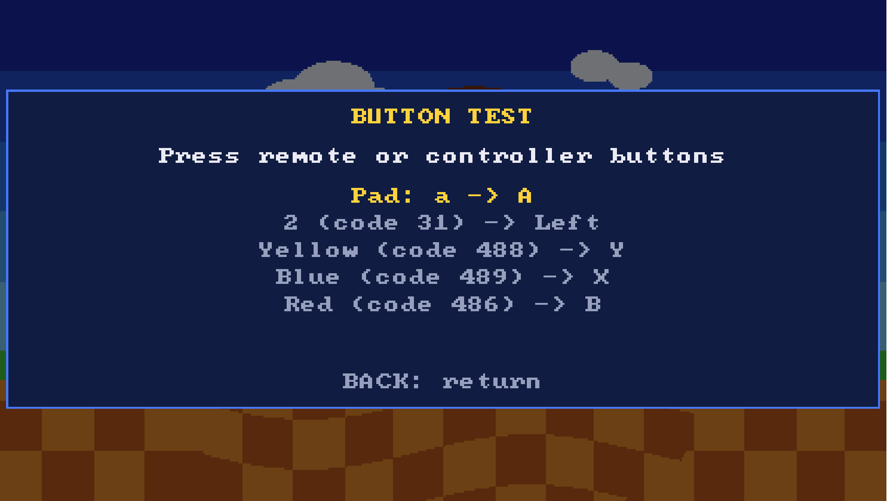
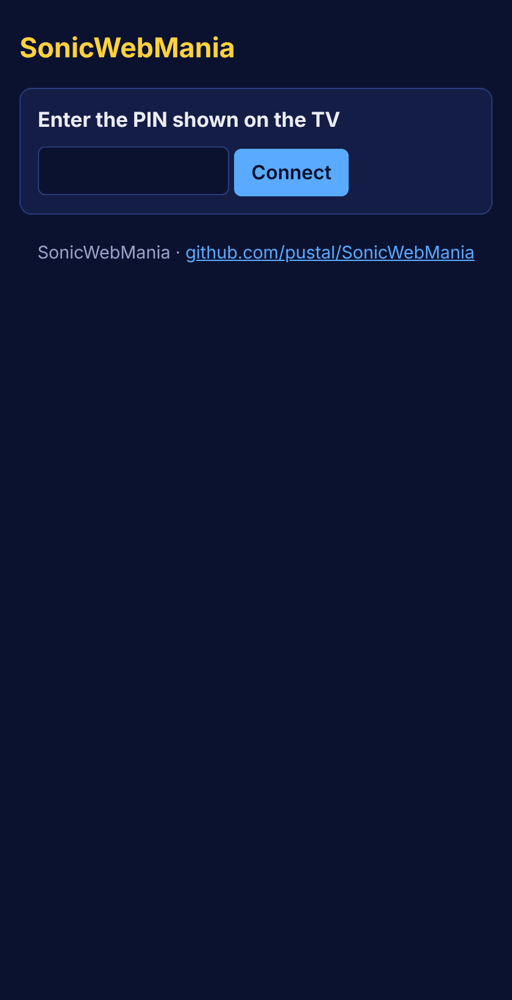
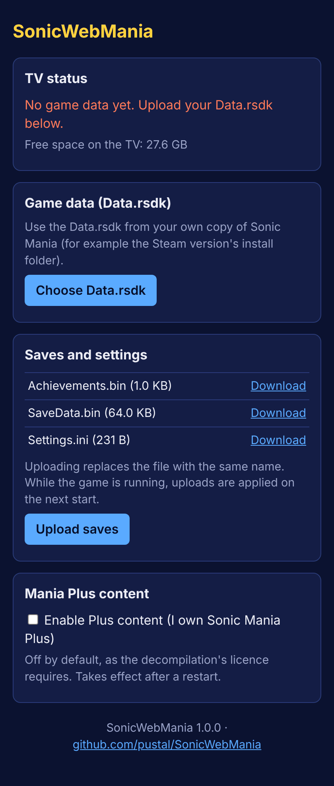

<p align="center"></p>

# SonicWebMania

**Version 2.1.0** · Sonic Mania for LG webOS TVs: the [RSDKv5](https://github.com/RSDKModding/RSDKv5-Decompilation)
and [Sonic Mania](https://github.com/RSDKModding/Sonic-Mania-Decompilation) decompilations,
built as a **native** webOS app (SDL2), with a few TV-friendly extras:

- **Bring your own data, from your phone.** On first launch the TV shows an address and
  a PIN. Open it on any phone or computer on the same network and upload the `Data.rsdk`
  from your own copy of the game, to the TV or a USB drive. No SSH needed. Sonic Mania
  is optional: the app can be used for the retro games alone.
- **Save transfer.** The same page lists your saves (Sonic Mania's and each retro
  game's) for download, and lets you upload saves from another device.
- **Plays with the remote.** Controllers work as usual; the remote is mapped too (below).
- **Back opens a small menu** at any time: Resume, Achievements, Button test, Retro games
  (when enabled), Restart game, Close app. It also shows the transfer address and this
  project's page.
- **Retro games (optional).** The engine also plays Sonic the Hedgehog, Sonic 2 and Sonic CD
  from your own data packs: those of Sonic Origins and/or of the earlier releases, with
  save slots, and Sonic Mania's music and sounds filling what the packs lack. See
  [Retro games](#retro-games).
- **Achievements.** The game's 18 achievements unlock as you play (the decompilation's
  engine records them in `Achievements.bin`, next to your saves). The menu lists them all,
  unlocked and locked, with how to get each one.
- **Light on storage.** Uploads are streamed straight to disk, free space is checked
  before anything is written, and the engine's log is off.

No game assets are included or downloaded by this project.

## Screenshots

These show the port's own screens; none of them contain game graphics. The scene behind
the menu is a stand-in drawn for the screenshot, where the paused game would be.

| First launch on the TV | Back menu during play |
|---|---|
|  |  |

| Achievements | Button test |
|---|---|
|  |  |

| Transfer page: PIN | Transfer page: data, saves and settings |
|---|---|
|  |  |

## Remote control

Hold the remote sideways, like a classic pad. The colour buttons match the Xbox
controller's buttons of the same colour:

| Button | Game |
|---|---|
| 2 / 8 / 6 / 4 | Left / Right / Up / Down |
| Green | A (jump) |
| Red | B (also jumps, as on a controller) |
| Blue | X |
| Yellow | Y |
| 0 | Start / Pause |
| Arrow keys, OK | D-pad, Start (unchanged) |
| Back (or Exit) | Port menu |

In the port menu, use 6/4 or the arrows to move, OK/0/Green to choose, Back/Red to resume.
On a controller, the Guide or View/Back button opens the menu; A chooses, B resumes.
The mapping lives in `src/port/RemoteInput.cpp` (`kMappings`).

**Button test** (in the Back menu) shows each press as the TV reports it and the game
button it becomes, for example `Red (code 486) -> B`. If a button does nothing in the game,
check it there: a press that doesn't appear at all never reached the app. Quick taps on the
remote are held for at least a frame, so the game never misses a short press.

## Transfer page

- Address: `http://<tv-ip>:47801` (shown on the TV; if that port is taken, the next free
  one up to 47810 is used and shown instead).
- Every API call needs the 4-digit PIN shown on the TV; a new PIN is generated each launch.
- Only devices on private networks (192.168.x.x, 10.x.x.x, 172.16-31.x.x) are answered.
- While the game is running, uploaded files are **staged** and applied the next time the
  game starts (Back > Restart game). The engine never sees a file change under it.
- Packs (Sonic Mania's `Data.rsdk` and the retro packs) can be kept on the TV or a USB
  drive, chosen in **Store packs on**, and moved between them later with each pack's
  **Move** button. Sonic Mania's goes in a `SonicWebMania` folder at the top of the drive.
  Only one copy is kept; if both exist, the TV's is used.
- The packs the running game reads from can't be moved, replaced or removed until you
  switch to another game (the engine reopens them for every file it reads). A new
  `Data.rsdk` for Sonic Mania is staged instead and installed at the next start.
- The Mania Plus content is **off by default** and can be enabled there (see Licence).

## Retro games

RSDKv5U, the engine revision this port builds, includes the RSDKv3 and RSDKv4 engines
behind Sonic CD and Sonic 1 and 2. Turn on **Retro games** on the transfer page and upload
each game's packs there. The **Retro games** page of the Back menu then switches between
Sonic Mania and every game that can be played (the app restarts into it). The app
starts with the last game you left normally.

Sonic Mania is optional. Without its `Data.rsdk` the retro games are always offered (the
toggle only matters next to Mania), and the first-run screen is done as soon as a retro
game can be played.

| Pack | Where it comes from |
|---|---|
| Sonic Origins | `Sonic1u.rsdk`, `Sonic2u.rsdk`, `SonicCDu.rsdk` from the game's install folder (`retro`) |
| Earlier release | Sonic 1 and 2 (2013): `Data.rsdk` (Android: `Data.rsdk.xmf` in the APK). Sonic CD (2011): `Data.rsdk.xmf` from the mobile app's APK, or `Data.rsdk` from Steam |

How each game plays depends on what you upload:

| Packs | Result |
|---|---|
| Origins + earlier release | The Origins game, with the earlier release's music and sound effects. The sounds Origins added (Drop Dash, Knuckles' and Amy's moves) come from Sonic Mania when it is installed, otherwise they are silent |
| Origins only | The Origins game. Origins keeps its audio outside these packs, so without Sonic Mania it is silent; with it, see **Sound from Sonic Mania** below |
| Earlier release only | Sonic 1 and 2: that release. Sonic CD: the mobile pack is the 2011 game, with its own menus, save slots and Time Attack. The Steam pack can't be played alone (its scripts are stored the way the PC build named them, which the engine doesn't load); it only adds sound to the Origins game |

- **Sound from Sonic Mania.** With Sonic Mania's `Data.rsdk` installed, whatever music or
  sound effect a retro game's packs lack comes from Mania's pack (on by default; a
  checkbox on the page turns it off). The game's own packs always win.
  - Sound effects: Mania's file of the same name (jumps, rings, springs, the Drop Dash,
    Knuckles' glide and climb...), or its nearest one; Amy's hammer uses Mania's hits
    and jumps.
  - Music: the zones and jingles Mania remixed, with Mania's loop points: Green Hill,
    Chemical Plant, Oil Ocean, Stardust Speedway and Metallic Madness (by time period),
    plus invincibility, speed shoes, act clear, boss, drowning, game over and Super.
  - **Similar music** (off by default): zones Mania has no version of get a Mania track
    of similar feel, such as Emerald Hill with Green Hill, Casino Night with Studiopolis,
    Aquatic Ruin and Tidal Tempest with Hydrocity, Mystic Cave and Quartz Quadrant with
    Lava Reef. The title, special stage and credits use Mania's own.

  A Mania track that only shares a name with a retro one (its title screen, credits) is
  not played unless similar music is on. The table is in `src/RetroAudio.cpp`.
- **Save slots.** Starting Sonic 1 or 2 opens a save screen: play without saving, or
  pick one of four slots to continue (zone, character, lives and emeralds are shown),
  start a new game, or delete it (press OK twice). New games then choose the character:
  Sonic, Tails, Knuckles, Sonic & Tails, and with the Origins packs Knuckles & Tails,
  Amy and Amy & Tails. The games save their own progress as you play (at the end of
  each act), as the 2013 releases did. The 2013 packs' title screen cannot start a game
  by itself (those releases used native menus), so for them the save screen opens when
  the title would start its demo. Sonic CD goes to its own 2011 menu instead: its save
  slots, Time Attack and extras. The mobile pack's menus work with the buttons, and also
  take a touch (a mouse click on a computer; the Magic Remote's pointer is untested).
- **Sonic Origins' modes.** With the Origins packs the save screen starts with a mode:
  - **Anniversary**: extra lives become coins, no time limit;
  - **Classic**: lives and the 10-minute time limit (and, in Sonic 1, no spin dash);
  - **Mirror**: Anniversary rules with the stages mirrored and left/right swapped (the HUD
    and title cards stay readable);
  - **Boss Rush** (experimental): the bosses one after another, without saving; a defeat
    retries the fight. Sonic 1's Boss Rush stages are whole acts, so, as Origins does,
    the port starts you at the act's last checkpoint, next to the boss. Moving on to the
    next boss is untested.

  Coins are kept in `RetroCoins.ini` in the app's data folder, shared by the three games as
  in Origins. Missions, the Museum and Story mode are part of Origins' own program, not of
  its packs, so they are not available.
- **Achievements.** Each game has its own twelve achievements (those of the 2013 and
  2011 releases, which the Origins packs share), unlocked as you play: a notice shows
  each one, the Back menu's Achievements page lists them, and they are kept in the game's
  `Achievements.bin`. Sonic CD's own menu entry opens the same list (its Leaderboards
  entry needs an online service, so it only says so).
- **Saves on the transfer page.** Saves and settings are listed per game (Sonic Mania,
  Sonic 1, 2 and CD) for download and upload. A retro game's files download as
  `<game>-<file>` (`sonic1-SGame.bin`) and can be uploaded under either name.
- **Storage.** The page offers each USB drive and the TV; a USB drive is chosen first, to
  spare the TV's space. Packs go in a `SonicWebMania/retro` folder on the drive (the page can
  create it), named `<game>-origins.rsdk` and `<game>-classic.rsdk` (`sonic1`, `sonic2`,
  `soniccd`). You can also copy them there yourself under those names, and move them
  between the TV and the drive later from the page.
- **Sonic CD's 2011 packs** (mobile and Steam) use an older format. The TV converts them on
  upload, which needs room for a second copy (about 75 MiB) for a moment. `tools/rsdk_v3_convert.py` does the
  same on a computer.
- Each game keeps its own settings and saves (`SGame.bin`) in `games/<game>/` in the
  app's data folder.
- Sonic 3 & Knuckles from Origins cannot be played: its game code lives in the Origins
  program, not in its pack.
- The engine changes this needed are in `patches/rsdk/0002-retro-games.patch`:
  - a second pack that fills in missing files (`Game:extraDataFile`);
  - absolute paths for packs on USB drives;
  - the 2013 packs' (RSDKvB) encryption keys;
  - Ogg sound effects, which the 2013 packs use and the engine could only read as `.wav`.
  `patches/rsdk/0003-retro-save-screen-hook.patch` calls the port when a legacy stage
  loads (the save screen) and once it has loaded (Boss Rush checkpoints);
  `0004-retro-mirror-mode.patch` mirrors the stage before the HUD is drawn and swaps left
  and right in Mirror mode; `0005-retro-achievements.patch` passes the games' achievement
  unlocks and Sonic CD's achievement menu to the port.
  `0006-retro-v3-input.patch` fixes how the RSDKv3 engine reads buttons in scripts that
  name no controller (the 2011 Sonic CD's): the engine looked up the controller by the
  object's slot, so most menu objects never saw a press. `0007-retro-mania-audio.patch`
  loads Sonic Mania's pack for audio only (`Game:audioDataFile`) and asks the port for
  stand-ins for missing music and sound effects.

## Disk space

Measured from the release build (`cmake --build build-webos --target webos-package`
prints these figures every time):

| What | Size |
|---|---|
| IPK download | ~2.1 MiB |
| Installed app (binary + bundled SDL2) | ~4.5 MiB |
| Your `Data.rsdk` | the size of your file |
| Retro game packs (optional, on the TV or a USB drive) | Origins 17-35 MiB each; earlier releases 43-75 MiB each |
| Saves and settings | well under 1 MiB (time-attack replays add a little) |
| Headroom required during an upload | 32 MiB, on top of the file being uploaded |

So the total is roughly **your Data.rsdk + 5 MiB**, and an upload needs
`Data.rsdk + 32 MiB` free while it runs. Replacing the data while the game runs keeps
both copies until the next start, so that needs room for two.

Data lives in the app's own folder (`$HOME/data` on the TV).

## Installing

Through the [webOS Homebrew Channel](https://github.com/webosbrew/webos-homebrew-channel):
open **Settings → Add repository**, add

```
https://pustal.github.io/webos-repo/api/apps.json
```

and install SonicWebMania from the list. Or download the `.ipk` from the
[latest release](https://github.com/pustal/SonicWebMania/releases/latest) and install it
with `ares-install` or webOS Dev Manager.

## Releasing

`cmake --build build-webos --target webos-package` writes two files to `dist/`:

- `org.sonicwebmania.app_<version>_arm.ipk`
- `org.sonicwebmania.app.manifest.json`, the Homebrew Channel manifest (version, `.ipk`
  name and its SHA-256)

Attach both to a GitHub release tagged `v<version>`. The webos-repo entry reads the
manifest of the latest release, so a new release reaches TVs with no other change.
The version comes from `project(... VERSION ...)` in `CMakeLists.txt`.

## Building

The webOS toolchain is Linux x86_64 only. On a Mac, build inside a Linux VM or a
container (for example `docker run -it -v "$PWD":/src ubuntu:24.04`).

```sh
git clone --recursive https://github.com/pustal/SonicWebMania.git
cd SonicWebMania
scripts/apply-patches.sh           # once after cloning or updating the engine

# Toolchain: https://github.com/openlgtv/buildroot-nc4/releases
#   arm-webos-linux-gnueabi_sdk-buildroot.tar.gz, then run its relocate-sdk.sh
export WEBOS_SDK=$HOME/arm-webos-linux-gnueabi_sdk-buildroot
npm install -g @webos-tools/cli    # for ares-package / ares-install

scripts/build-webos.sh             # -> dist/org.sonicwebmania.app_<version>_arm.ipk
```

Install with `ares-install dist/*.ipk` (or `cmake --build build-webos --target webos-install`,
with `-DSWM_ARES_DEVICE=<name>` to pick the TV), or with webOS Dev Manager.
Developer Mode or a rooted TV is required, as for any homebrew app.

### Desktop build (for testing)

```sh
sudo apt install cmake ninja-build libsdl2-dev
cmake -B build -G Ninja && cmake --build build
./build/rsdk/SonicWebMania          # data in ~/.local/share/SonicWebMania (or $SWM_DATA_DIR)
```

Escape opens the port menu on a keyboard.

## How it is put together

```
src/main.cpp                launcher: storage, transfer server, setup screen, picks the game, then the engine
src/RetroSaves.cpp          retro games' save slots, Origins modes, coins and Mirror mode (engine side)
src/RetroAudio.cpp          Sonic Mania stand-ins for the retro games' missing music and sounds
src/port/
  WebOSPortHooks.h          the C interface the engine calls
  PortRuntime.*             implements the hooks: Back menu (achievements, button test,
                            retro games), notifications, Plus opt-in
  RetroGames.*              Sonic 1, 2 and CD: finds their packs, plans Origins + classic, per-game folders
  IniEdit.*                 rewrites the pack paths in Settings.ini before each start
  SaveSelect.h              what the retro games' save screen shows and returns
  RetroAchievements.*       the retro games' achievement lists
  RsdkPack.*                looks inside packs; converts Sonic CD's 2011 pack
  Md5.*                     MD5 for pack file names
  UsbDrives.*               mounted USB drives (from /proc/mounts)
  Achievements.h            achievement entries the menu shows (read from the engine in main.cpp)
  RemoteInput.*             remote button mapping and menu navigation
  SetupScreen.*             first-run screen (address, PIN, free space, progress)
  TransferServer.*          HTTP server (cpp-httplib) for data and saves
  Storage.*                 data folder, Sonic Mania's pack (TV or USB), free space, staged uploads, log trimming
  PortConfig.*              port.ini (Plus and retro opt-ins, Mania audio settings, last game)
  PortInfo.h                app version (from CMake) and project address
  BitmapFont.* TextRenderer.cpp   built-in 8x8 font, so text works before any game data exists
web/index.html              the transfer page, embedded into the binary at build time
patches/rsdk/               engine patches, applied by scripts/apply-patches.sh: 0001 hook call sites in the
                            SDL2 device + the Plus gate; 0002 retro games; 0003 save screen hook;
                            0004 Mirror mode; 0005 retro achievements; 0006 RSDKv3 script input;
                            0007 Sonic Mania audio for retro games (see Retro games)
tools/                      rsdk_table.py (compare pack contents), rsdk_v3_convert.py (Sonic CD 2011 pack)
cmake/WriteManifest.cmake       Homebrew Channel manifest for each release
scripts/make-icon.py        draws the app icon and README logo (original pixel art with the name)
cmake/RSDKPlatform-webOS.cmake   RSDK platform file (SDL2 backend, our main, static libstdc++)
cmake/SDL2WebOSBackport.cmake    bundles webosbrew's SDL-webOS 2.30 (remote keys, Back/Exit delivery)
external/                   submodules: engine, game, cpp-httplib, libogg, libtheora
```

## Licence

See `LICENSE.md`. In short: this is a non-commercial project built on the RSDKv5 and
Sonic Mania decompilations by Rubberduckycooly and chuliRMG; their licences apply to
the whole repository. Builds must keep the Plus content off by default, may not be sold
or used for profit, and may not include game assets.

Sonic Mania, Sonic the Hedgehog, Sonic CD and Sonic Origins are trademarks of SEGA. This project is not affiliated with SEGA.
