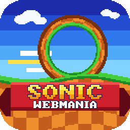
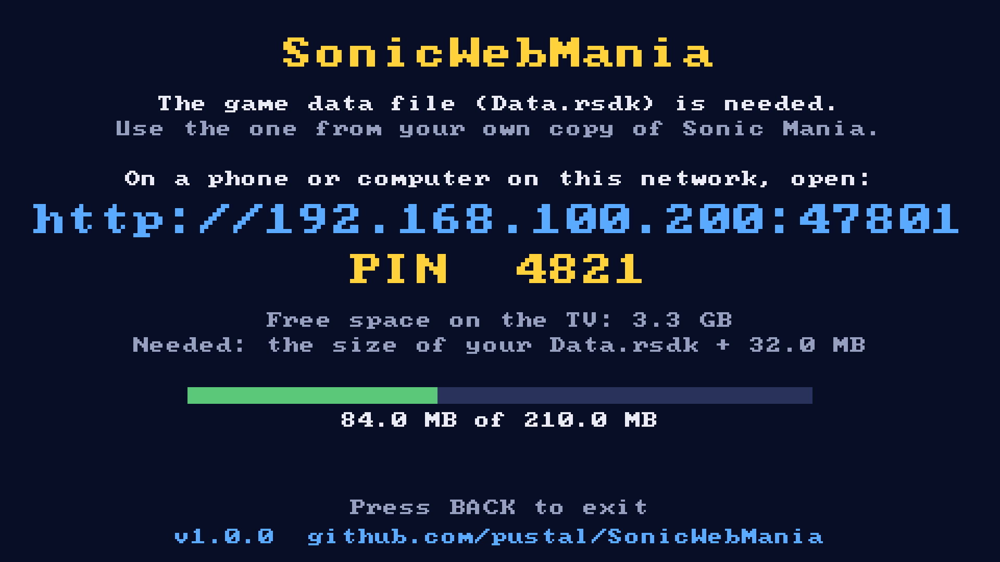
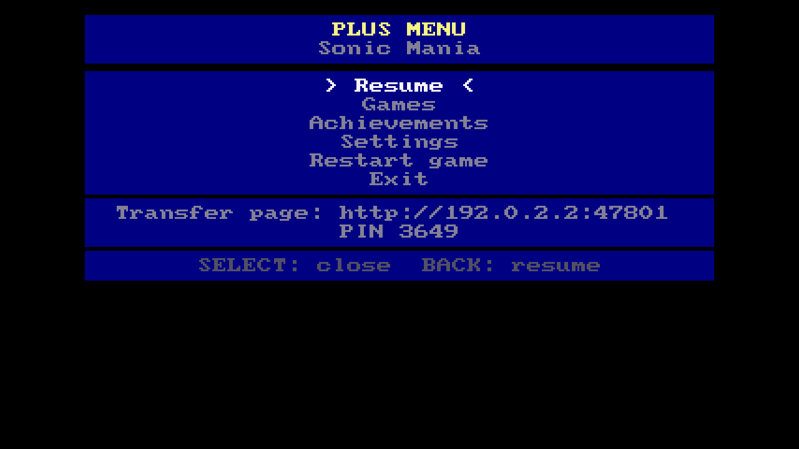
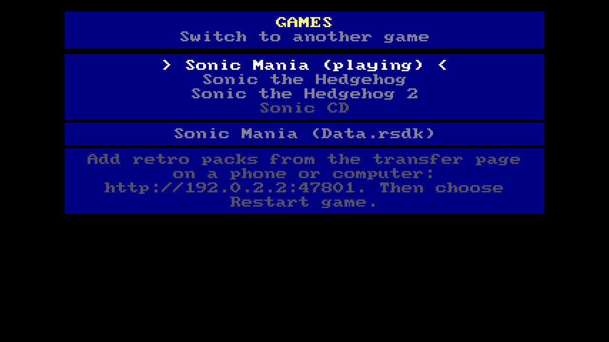
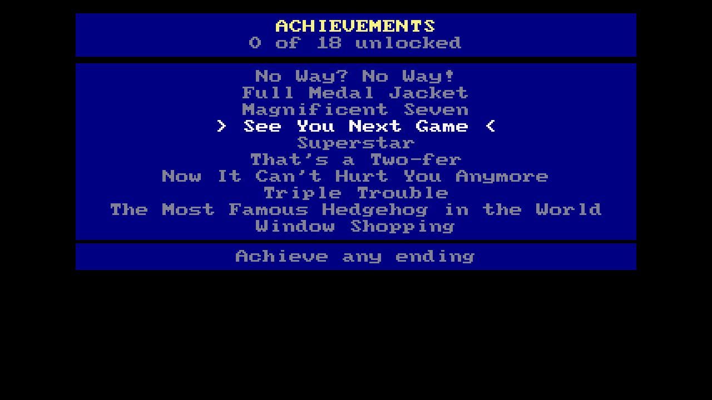
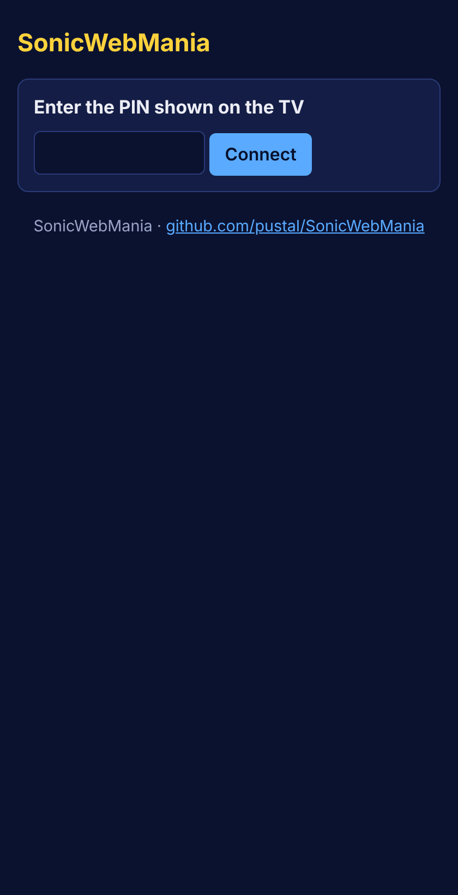
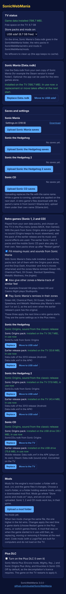

<p align="center"></p>

# SonicWebMania

**Version 3.2.0** · Sonic Mania for LG webOS TVs: the [RSDKv5](https://github.com/RSDKModding/RSDKv5-Decompilation)
and [Sonic Mania](https://github.com/RSDKModding/Sonic-Mania-Decompilation) decompilations, through their Plus
forks ([RSDKv5-Decompilation-Plus](https://github.com/pustal/RSDKv5-Decompilation-Plus) and
[Sonic-Mania-Decompilation-Plus](https://github.com/pustal/Sonic-Mania-Decompilation-Plus)), built as a
**native** webOS app (SDL2), with a few TV-friendly extras:

- **Bring your own data, from your phone.** On first launch the TV shows an address and
  a PIN. Open it on any phone or computer on the same network and upload the `Data.rsdk`
  from your own copy of the game, to the TV or a USB drive. No SSH needed. Sonic Mania
  is optional: the app can be used for the retro games alone.
- **Save transfer.** The same page lists your saves (Sonic Mania's and each retro
  game's) for download, and lets you upload saves from another device.
- **Plays with the remote.** Controllers work as usual; the remote is mapped too (below).
- **Back opens the Plus menu** at any time: Resume, Games, Achievements, Settings, Restart
  game, Exit. It also shows the transfer page's address and PIN.
- **Retro games.** The engine also plays Sonic the Hedgehog, Sonic 2 and Sonic CD from
  your own data packs: those of Sonic Origins and/or of the earlier releases, with save
  slots, Sonic Origins' own music and sounds (uploaded from its files and converted on the
  TV), and Sonic Mania's filling what is left. The Plus menu's
  Games page switches between them and Sonic Mania. See [Retro games](#retro-games).
- **Achievements.** The game's 18 achievements unlock as you play (the engine records them
  in `Achievements.bin`, next to your saves). The menu lists them all, unlocked and locked,
  with how to get each one; each retro game has its own twelve.
- **Mods.** The engine's mod loader is on: upload a mod's folder (or a folder of mods) from
  the transfer page, to the TV or a USB drive, and turn each on or off. See [Mods](#mods).
- **Light on storage.** Uploads are streamed straight to disk, free space is checked
  before anything is written, and the engine's log is off.

No game assets are included or downloaded by this project.

The games, their menu and the retro games come from the Plus forks, which also build for
Windows, macOS, Linux, Android and the Switch: for those platforms, see
[Sonic Mania Decompilation Plus](https://github.com/pustal/Sonic-Mania-Decompilation-Plus).
This project is the TV app around them: the setup screen, the transfer page, USB drives
and the remote.

## Screenshots

These show the app's own screens and the Plus menu; none of them contain game graphics
(the menu was opened before the game had drawn anything behind it).

| First launch on the TV | Plus menu (Back) |
|---|---|
|  |  |

| Games | Achievements |
|---|---|
|  |  |

| Transfer page: PIN | Transfer page: data, saves and settings |
|---|---|
|  |  |

## Remote control

Hold the remote sideways, like a classic pad. The colour buttons match the Xbox
controller's buttons of the same colour:

| Button | Game |
|---|---|
| 2 / 8 / 6 / 4 | Left / Right / Up / Down |
| Green | A (jump) |
| Red | B (also jumps, as on a controller) |
| Blue | X |
| Yellow | Y |
| 0 | Start / Pause |
| Arrow keys, OK | D-pad, Start (unchanged) |
| Back (or Exit) | Plus menu |

In the Plus menu, use 6/4 or the arrows to move, OK/0/Green to choose, Back/Red to go back
a page (or resume). On a controller, View/Back (Select) opens and closes it; A chooses,
B goes back. The mapping lives in `src/port/RemoteInput.cpp` (`kMappings`). Quick taps on
the remote are held for at least a frame, so the game never misses a short press.

## Transfer page

- Address: `http://<tv-ip>:47801` (shown on the TV; if that port is taken, the next free
  one up to 47810 is used and shown instead).
- Every API call needs the 4-digit PIN shown on the TV; a new PIN is generated each launch.
- Only devices on private networks (192.168.x.x, 10.x.x.x, 172.16-31.x.x) are answered.
- While the game is running, uploaded files are **staged** and applied the next time the
  app starts (Back > Restart game). The engine never sees a file change under it. New retro
  packs show up in the Games page after a restart too.
- Packs (Sonic Mania's `Data.rsdk` and the retro packs) can be kept on the TV or a USB
  drive, chosen in **Store packs on**, and moved between them later with each pack's
  **Move** button. Sonic Mania's goes in a `SonicWebMania` folder at the top of the drive.
  Only one copy is kept; if both exist, the TV's is used.
- The engine reopens a pack for every file it reads, and the Plus menu can switch to any
  game, so every pack found at launch counts as in use: replacing or moving one copies it
  now and switches at the next start (the page says so), and removing one waits until then.
- **Sonic Origins audio**: upload Sonic Origins' sound files, convert them (the TV does
  it, in the background; the page shows its progress), remove a game's converted audio,
  and remove the uploaded files once converted.
- **Clean up** removes what interrupted uploads, moves and Sonic CD conversions leave
  behind (`.part` and `.conv` files, on the TV and the drives). The app keeps no cache;
  files waiting for the next start are left alone.
- **Settings**: the Plus DLC and the retro games' audio settings, the same as in the Plus
  menu's Settings page. A change applies right away (the Plus DLC restarts the game; the
  audio settings apply the next time a retro game starts).
- The **Plus DLC** (Sonic Mania Plus, and Sonic Origins Plus in the retro games) is **off by
  default**, as the decompilation's licence requires, and can be turned on there or in the
  Plus menu if you own it (see Licence).

## Retro games

RSDKv5U, the engine revision this port builds, includes the RSDKv3 and RSDKv4 engines
behind Sonic CD and Sonic 1 and 2, and the Plus fork's Plus module plays them next to Sonic
Mania. Upload each game's packs on the transfer page, choose **Restart game** in the Plus
menu, and its **Games** page lists every game that can be played: choosing one switches to
it in place. The app starts with the last game played.

Sonic Mania is optional: without its `Data.rsdk` the app starts the first retro game, and
the first-run screen is done as soon as a retro game can be played.

| Pack | Where it comes from |
|---|---|
| Sonic Origins | `Sonic1u.rsdk`, `Sonic2u.rsdk`, `SonicCDu.rsdk` from the game's install folder (`retro`) |
| Earlier release | Sonic 1 and 2 (2013): `Data.rsdk` (Android: `Data.rsdk.xmf` in the APK). Sonic CD (2011): `Data.rsdk.xmf` from the mobile app's APK, or `Data.rsdk` from Steam |

How each game plays depends on what you upload:

| Packs | Result |
|---|---|
| Origins + Sonic Origins audio | The Origins game with Sonic Origins' own music and sounds (see **Sonic Origins' audio** below); the earlier release's pack and Sonic Mania fill any gaps |
| Origins + earlier release | The Origins game, with the earlier release's music and sound effects. The sounds Origins added (Drop Dash, Knuckles' and Amy's moves) come from Sonic Mania when it is installed, otherwise they are silent |
| Origins only | The Origins game. Origins keeps its audio outside these packs, so without Sonic Origins' audio or Sonic Mania it is silent |
| Earlier release only | Sonic 1 and 2: that release. Sonic CD: the mobile pack is the 2011 game, with its own menus, save slots and Time Attack. The Steam pack can't be played alone (its scripts are stored the way the PC build named them, which the engine doesn't load); it only adds sound to the Origins game |

- **Sonic Origins' audio.** Sonic Origins plays the games' music and sounds from files of
  its own, not from its packs. On the transfer page, **Sonic Origins audio** takes them from
  its `image/x64/raw/sound` folder (choose them all at once; the page keeps the ones it
  needs: `HITE_sfx.acb`, and `STH1`, `STH2`, `SCD` `_sfx.acb`, `_music.acb`, `_music.awb`,
  about 380 MB in all) and **Convert** has the TV write one pack per game,
  `<game>-origins-audio.rsdk` (about 30, 70 and 250 MB), next to the files (on the TV or the
  drive, as "Store packs and mods on" says). The Plus menu's Settings can convert too. A
  retro game being played restarts when it is done; the uploaded files can then be
  removed. Music loops at Origins' own loop points and the speed shoes play the zone's
  track faster, as in Origins. Sounds then come from Sonic Origins first, then from the
  earlier release's pack, then from Sonic Mania's.
- **Sound from Sonic Mania.** With Sonic Mania's `Data.rsdk` installed, whatever music or
  sound effect a retro game's packs lack comes from Mania's pack (on by default; a
  checkbox on the page turns it off). The game's own packs always win.
  - Sound effects: Mania's file of the same name (jumps, rings, springs, the Drop Dash,
    Knuckles' glide and climb...), or its nearest one; Amy's hammer uses Mania's hits
    and jumps.
  - Music: the zones and jingles Mania remixed, with Mania's loop points: Green Hill,
    Chemical Plant and Oil Ocean (Mania's act 1 remix in act 1, its act 2 remix from
    act 2 on), Stardust Speedway and Metallic Madness (by time period), plus
    invincibility, speed shoes, act clear, boss, drowning, game over and Super.
  - **Mania remixes** (off by default): those zones play Mania's remix even when the
    earlier release's pack has the original, and their speed shoes play Mania's jingle.
  - **Similar music** (off by default): zones Mania has no version of get a Mania track
    of similar feel, such as Emerald Hill with Green Hill, Casino Night with Studiopolis,
    Aquatic Ruin and Tidal Tempest with Hydrocity, Mystic Cave and Quartz Quadrant with
    Lava Reef. The title, special stage and credits use Mania's own.

  A Mania track that only shares a name with a retro one (its title screen, credits) is
  not played unless similar music is on. The table is in the engine fork's
  `RSDKv5/RSDK/Plus/PlusAudio.cpp`.
- **Save slots.** Starting Sonic 1 or 2 opens a save screen: play without saving, or
  pick one of four slots to continue (zone, character, lives and emeralds are shown),
  start a new game, or delete it (press OK twice). New games then choose the character:
  Sonic, Tails, Knuckles, Sonic & Tails, with the Origins packs Knuckles & Tails, and with
  the Plus DLC on, Amy and Amy & Tails. The games save their own progress as you play (at the end of
  each act), as the 2013 releases did. The 2013 packs' title screen cannot start a game
  by itself (those releases used native menus), so for them the save screen opens when
  the title would start its demo. Sonic CD goes to its own 2011 menu instead: its save
  slots, Time Attack and extras. The mobile pack's menus work with the buttons, and also
  take a touch (a mouse click on a computer; the Magic Remote's pointer is untested).
- **Sonic Origins' modes.** With the Origins packs the save screen starts with a mode:
  - **Anniversary**: extra lives become coins, no time limit;
  - **Classic**: lives and the 10-minute time limit (and, in Sonic 1, no spin dash);
  - **Mirror**: Anniversary rules with the stages mirrored and left/right swapped (the HUD
    and title cards stay readable);
  - **Boss Rush** (experimental): the bosses one after another, without saving; a defeat
    retries the fight. Sonic 1's Boss Rush stages are whole acts, so, as Origins does,
    the port starts you at the act's last checkpoint, next to the boss. Moving on to the
    next boss is untested.

  Coins are kept in `Plus.ini` in the app's data folder, shared by the three games as in
  Origins. Missions, the Museum and Story mode are part of Origins' own program, not of
  its packs, so they are not available.
- **Achievements.** Each game has its own twelve achievements (those of the 2013 and
  2011 releases, which the Origins packs share), unlocked as you play: a notice shows
  each one, the Plus menu's Achievements page lists them, and they are kept in the game's
  `Achievements.bin`. Sonic CD's own menu entry opens the same list (its Leaderboards
  entry needs an online service, so it only says so).
- **Saves on the transfer page.** Saves and settings are listed per game (Sonic Mania,
  Sonic 1, 2 and CD) for download and upload. A retro game's files download as
  `<game>-<file>` (`sonic1-SGame.bin`) and can be uploaded under either name.
- **Storage.** The page offers each USB drive and the TV; a USB drive is chosen first, to
  spare the TV's space. Packs go in a `SonicWebMania/retro` folder on the drive (the page can
  create it), named `<game>-origins.rsdk` and `<game>-classic.rsdk` (`sonic1`, `sonic2`,
  `soniccd`). You can also copy them there yourself under those names, and move them
  between the TV and the drive later from the page.
- **Sonic CD's 2011 packs** (mobile and Steam) use an older format. The TV converts them on
  upload, which needs room for a second copy (about 75 MiB) for a moment. `tools/rsdk_v3_convert.py` does the
  same on a computer.
- Each game keeps its saves (`SGame.bin`, `Achievements.bin`) in `retro/<game>/` in the
  app's data folder; the settings are shared, in `Settings.ini` and `Plus.ini`.
- Sonic 3 & Knuckles from Origins cannot be played: its game code lives in the Origins
  program, not in its pack.
- All of this is the engine fork's Plus module (`RSDKv5/RSDK/Plus/` in
  RSDKv5-Decompilation-Plus). The app only tells it what the TV knows, through its platform
  API (`RSDK::Plus::AddPackFolder()` and friends): the packs on USB drives, the transfer
  page's address, settings changed on the page, and the **Restart game** entry.
- **Updating from 2.x.** The first start of 3.0 moves the earlier version's settings
  (`port.ini`), coins (`RetroCoins.ini`) and retro saves (`games/<game>/`) to where the
  engine keeps them. The retro games no longer need turning on: they are offered whenever
  their packs are there.

## Mods

The engine's mod loader (from the RSDKv5 decompilation) loads mods for Sonic Mania, and for
Sonic 1, 2 and CD in their own game: a mod is a folder with a `mod.ini` (its name, author,
version and the engine it targets) and the game files it replaces.

- **Upload** on the transfer page: **Upload a mod folder** takes a mod's folder, or a folder
  holding several mods (each folder with a `mod.ini` becomes one). Unzip a downloaded mod
  first. Mods go where **Store packs and mods on** says, and are on once uploaded.
- **On the TV** they live in `mods/<folder>` in the app's data folder; **on a USB drive** in
  `SonicWebMania/mods/<folder>`. The engine only looks in its own folder, so at each start the
  app links each drive's mods into it (a mod on the TV wins over one of the same name).
- **Manage** each mod there: on or off, up or down (when two mods change the same file, the
  higher one wins), move between the TV and a drive, or remove. The list is the engine's own
  `mods/modconfig.ini`.
- Changes apply the next time a game starts: **Restart game** in the Plus menu, or switching
  games there. A mod that was on when the game started is in use until then, so replacing,
  moving or removing it is staged and finishes at the next start.
- **Code mods** (a `LogicFile` in `mod.ini`) are libraries built for one system; those made
  for Windows or desktop Linux don't load on the TV, and the page says so.
- **Clean up** also removes what interrupted mod uploads and moves leave behind
  (`<folder>.part`).

## Disk space

Measured from the release build (`cmake --build build-webos --target webos-package`
prints these figures every time):

| What | Size |
|---|---|
| IPK download | ~2.3 MiB |
| Installed app (binary + bundled SDL2) | ~5 MiB |
| Your `Data.rsdk` | the size of your file |
| Retro game packs (optional, on the TV or a USB drive) | Origins 17-35 MiB each; earlier releases 43-75 MiB each |
| Sonic Origins' audio (optional) | the uploaded files ~380 MiB (removable once converted); converted packs ~30, 66 and 240 MiB |
| Saves and settings | well under 1 MiB (time-attack replays add a little) |
| Headroom required during an upload | 32 MiB, on top of the file being uploaded |

So the total is roughly **your Data.rsdk + 5 MiB**, and an upload needs
`Data.rsdk + 32 MiB` free while it runs. Replacing the data while the game runs keeps
both copies until the next start, so that needs room for two.

Data lives in the app's own folder (`$HOME/data` on the TV).

## Installing

Through the [webOS Homebrew Channel](https://github.com/webosbrew/webos-homebrew-channel):
open **Settings → Add repository**, add

```
https://pustal.github.io/webos-repo/api/apps.json
```

and install SonicWebMania from the list. Or download the `.ipk` from the
[latest release](https://github.com/pustal/SonicWebMania/releases/latest) and install it
with `ares-install` or webOS Dev Manager.

## Releasing

`cmake --build build-webos --target webos-package` writes two files to `dist/`:

- `org.sonicwebmania.app_<version>_arm.ipk`
- `org.sonicwebmania.app.manifest.json`, the Homebrew Channel manifest (version, `.ipk`
  name and its SHA-256)

Attach both to a GitHub release tagged `v<version>`. The webos-repo entry reads the
manifest of the latest release, so a new release reaches TVs with no other change.
The version comes from `project(... VERSION ...)` in `CMakeLists.txt`.

## Building

The webOS toolchain is Linux x86_64 only. On a Mac, build inside a Linux VM or a
container (for example `docker run -it -v "$PWD":/src ubuntu:24.04`).

```sh
git clone https://github.com/pustal/SonicWebMania.git
cd SonicWebMania
git submodule update --init        # not --recursive: the game's own copy of the engine isn't needed
git -C external/RSDKv5-Decompilation-Plus submodule update --init

# Toolchain: https://github.com/openlgtv/buildroot-nc4/releases
#   arm-webos-linux-gnueabi_sdk-buildroot.tar.gz, then run its relocate-sdk.sh
export WEBOS_SDK=$HOME/arm-webos-linux-gnueabi_sdk-buildroot
npm install -g @webos-tools/cli    # for ares-package / ares-install

scripts/build-webos.sh             # -> dist/org.sonicwebmania.app_<version>_arm.ipk
```

Install with `ares-install dist/*.ipk` (or `cmake --build build-webos --target webos-install`,
with `-DSWM_ARES_DEVICE=<name>` to pick the TV), or with webOS Dev Manager.
Developer Mode or a rooted TV is required, as for any homebrew app.

### Desktop build (for testing)

```sh
sudo apt install cmake ninja-build libsdl2-dev
cmake -B build -G Ninja && cmake --build build
./build/rsdk/SonicWebMania          # data in ~/.local/share/SonicWebMania (or $SWM_DATA_DIR)
```

Escape (or Tab) opens the Plus menu on a keyboard.

## How it is put together

```
src/main.cpp                launcher: storage, transfer server, setup screen, then the engine, told about
                            USB packs, the transfer page and page settings (RSDK::Plus platform API)
src/port/
  PortRuntime.*             the remote's buttons, rewritten for the engine (an SDL event filter)
  RemoteInput.*             remote button mapping, Back for the Plus menu, menu navigation (setup screen)
  SettingsChannel.*         hands the page's settings changes to the engine's thread
  PlusFiles.*               reads the engine's Plus.ini / Settings.ini; moves a 2.x install's settings and saves
  RetroGames.*              Sonic 1, 2 and CD: finds their packs (TV and USB) for the page and the setup screen
  ModLibrary.*              mods on the TV and USB drives, modconfig.ini, staged changes, links for the engine
  IniEdit.*                 rewrites Sonic Mania's pack path in Settings.ini before each start
  RsdkPack.*                looks inside packs; converts Sonic CD's 2011 pack
  Md5.*                     MD5 for pack file names
  UsbDrives.*               mounted USB drives (from /proc/mounts)
  SetupScreen.*             first-run screen (address, PIN, free space, progress)
  TransferServer.*          HTTP server (cpp-httplib) for data, saves, mods and settings
  Storage.*                 data folder, Sonic Mania's pack (TV or USB), free space, staged uploads, log trimming
  PortInfo.h                app version (from CMake) and project address
  BitmapFont.* TextRenderer.cpp   built-in 8x8 font, so text works before any game data exists
web/index.html              the transfer page, embedded into the binary at build time
tools/                      rsdk_table.py (compare pack contents), rsdk_v3_convert.py (Sonic CD 2011 pack)
cmake/WriteManifest.cmake       Homebrew Channel manifest for each release
scripts/make-icon.py        draws the app icon and README logo (original pixel art with the name)
cmake/RSDKPlatform-webOS.cmake   RSDK platform file (SDL2 backend, our main, static libstdc++)
cmake/SDL2WebOSBackport.cmake    bundles webosbrew's SDL-webOS 2.30 (remote keys, Back/Exit delivery)
external/                   submodules: the engine and the game (the Plus forks), cpp-httplib, libogg, libtheora
```

## Licence

See `LICENSE.md`. In short: this is a non-commercial project built on the RSDKv5 and
Sonic Mania decompilations by Rubberduckycooly and chuliRMG (through their Plus forks). The port's own code has its
own licence, the SonicWebMania licence, on the same terms as theirs, and their licences
apply to the whole repository. Builds must keep the Plus DLC off by default, may not be sold
or used for profit, and may not include game assets.

Sonic Mania, Sonic the Hedgehog, Sonic CD and Sonic Origins are trademarks of SEGA. This project is not affiliated with SEGA.
